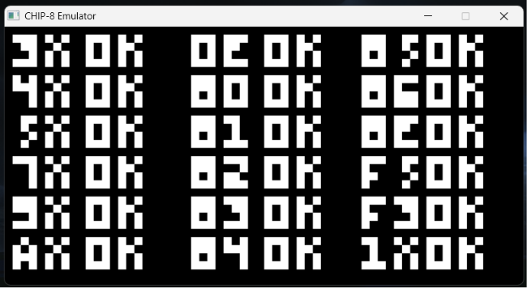
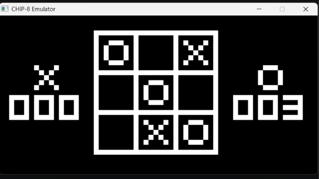

# CHIP-8 Emulator

My attempt at recreating a CHIP-8 emulator in C++ by following Austin Morlan's tutorial:
[Writing a CHIP-8 Emulator](https://austinmorlan.com/posts/chip8_emulator/#how-does-a-cpu-work).

It uses SDL2 for video and keyboard input.

## Screenshots

**Passing the opcode test ROM**



**Tic-Tac-Toe**



## Running it

A prebuilt `ch8.exe` is included (Windows). Usage:

```
ch8.exe <Scale> <Delay> <ROM>
```

- `Scale`: window size multiplier (CHIP-8 is 64x32, so `10` gives 640x320)
- `Delay`: milliseconds between CPU cycles (lower is faster; `1`-`3` is a good start)
- `ROM`: path to a `.ch8` file

Example:

```
ch8.exe 10 3 "ch8 ROM\Tic-Tac-Toe.ch8"
```

ROMs are in the `ch8 ROM` folder: `test_opcode.ch8`, `Tic-Tac-Toe.ch8`, `Tetris.ch8`.

## Building from source

You need a C++ compiler and the SDL2 development libraries. With g++ (MinGW):

```
g++ main.cpp -o ch8 -lmingw32 -lSDL2main -lSDL2
```

Add `-I`/`-L` paths if SDL2 isn't on your default include/library path, and keep `SDL2.dll` next to `ch8.exe`.

## Controls

The original CHIP-8 hex keypad is mapped onto the left of the keyboard:

```
CHIP-8        Keyboard
1 2 3 C       1 2 3 4
4 5 6 D   ->  Q W E R
7 8 9 E       A S D F
A 0 B F       Z X C V
```

Press `Esc` to quit.
